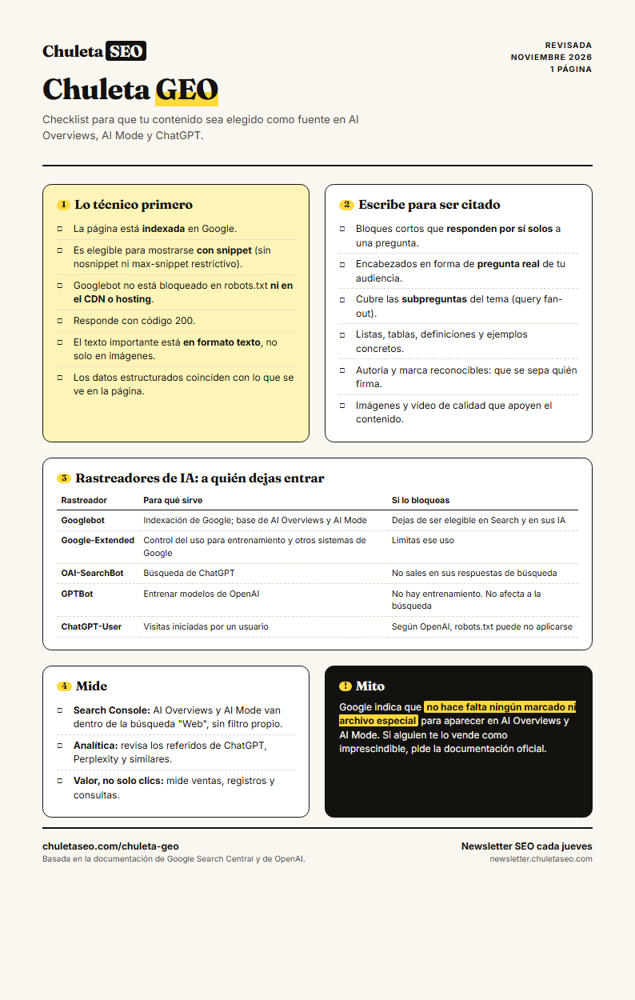

{:.lead} Una página, cuatro bloques y cero relleno. La Chuleta GEO resume lo que Google y OpenAI documentan para que tu contenido sea elegido como fuente en la búsqueda con IA.

  <a class="btn btn-primary" href="/chuletas/chuleta-geo.pdf" download onclick="window.dataLayer=window.dataLayer||[];window.dataLayer.push({event:'chuleta_download',chuleta:'geo'});">Descargar la Chuleta GEO (PDF)</a>

## Qué incluye

1. **Lo técnico primero:** los requisitos mínimos para ser elegible como fuente en Google.
2. **Escribe para ser citado:** cómo estructurar el contenido para que una IA pueda usarlo.
3. **Rastreadores de IA:** qué hace cada bot (Googlebot, Google-Extended, OAI-SearchBot, GPTBot y ChatGPT-User) y qué pasa si lo bloqueas.
4. **Mide y mitos:** dónde ver el efecto y qué cosas no hacen falta.

## Para quién es

Para quien trabaja en SEO y quiere un resumen imprimible para revisar una web, o para pasárselo a un cliente o a un equipo de contenidos.

## Si quieres la explicación completa

La chuleta es el resumen. El razonamiento detrás de cada punto, con las fuentes oficiales, está en la guía de [SEO e inteligencia artificial](https://chuletaseo.com/seo-inteligencia-artificial).

La información de la chuleta está revisada en noviembre de 2026. Las políticas de los buscadores cambian, y las novedades las cuento cada semana en la newsletter.
