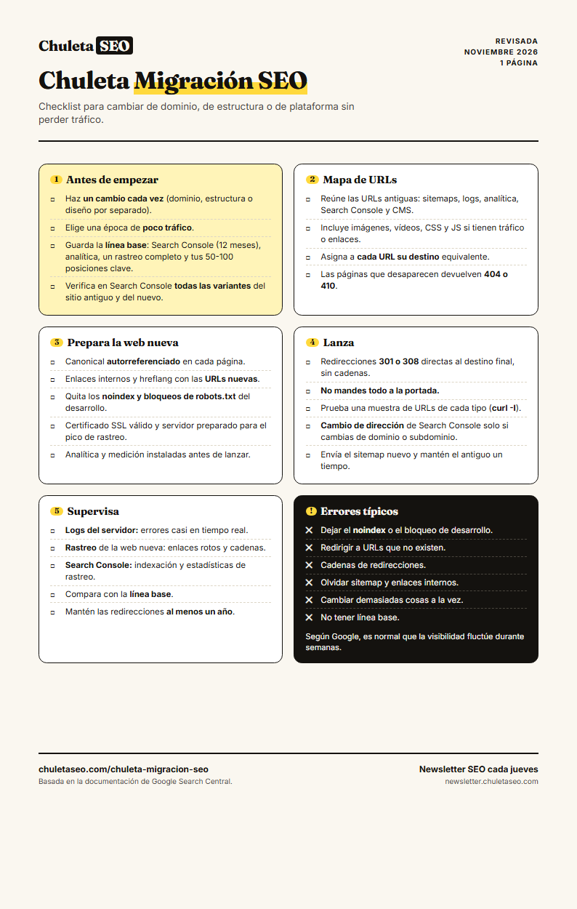

Una página con el orden de trabajo de una migración SEO: qué guardar antes, cómo preparar el mapa de redirecciones, qué comprobar al lanzar y qué vigilar después.
{:.lead}

  <a class="btn btn-primary" href="/chuletas/chuleta-migracion-seo.pdf" download onclick="window.dataLayer=window.dataLayer||[];window.dataLayer.push({event:'chuleta_download',chuleta:'migracion'});">Descargar la Chuleta Migración SEO (PDF)</a>

## Qué incluye

1. **Antes de empezar:** un solo cambio cada vez y la línea base que hay que guardar.
2. **Mapa de URLs:** cómo reunir las URLs antiguas y qué hacer con las que desaparecen.
3. **Prepara la web nueva:** canonical, enlaces internos, robots.txt, noindex y certificado.
4. **Lanza:** redirecciones directas, pruebas con `curl -I`, cambio de dirección y sitemaps.
5. **Supervisa:** logs, rastreo, Search Console y comparación con la línea base.
6. **Errores típicos:** los fallos que más veces se repiten.

## Para quién es

Para quien va a cambiar de dominio, de estructura de URLs, de protocolo o de plataforma, y quiere un resumen imprimible para el equipo o para el cliente.

## Si quieres la explicación completa

La chuleta es el resumen. El detalle de cada paso está en la guía de [migración SEO](https://chuletaseo.com/migracion-seo), que se apoya en las recomendaciones oficiales de Google. Para las redirecciones en Apache, tienes la guía de [códigos .htaccess](https://chuletaseo.com/codigos-htaccess-apache).

Revisada en noviembre de 2026. Las recomendaciones de los buscadores cambian, y las novedades las cuento cada semana en la newsletter.
