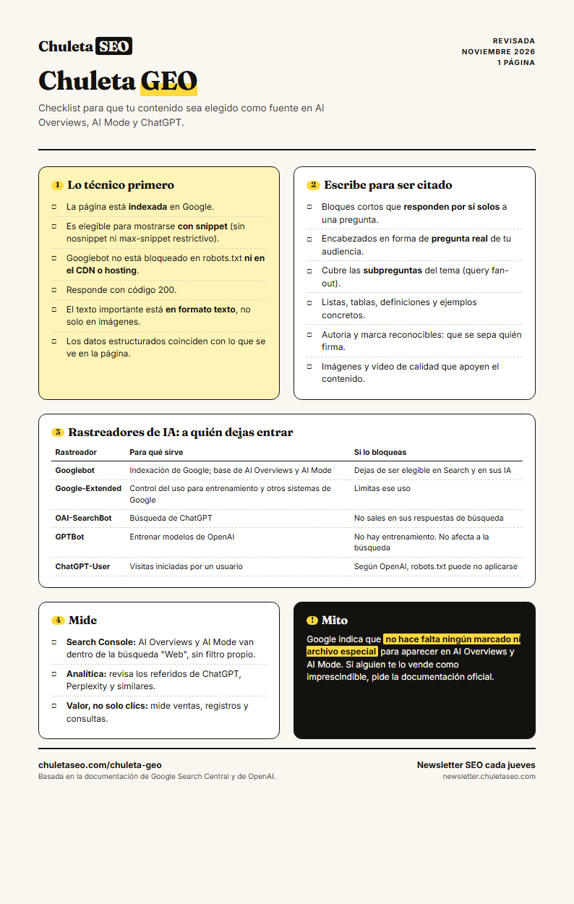
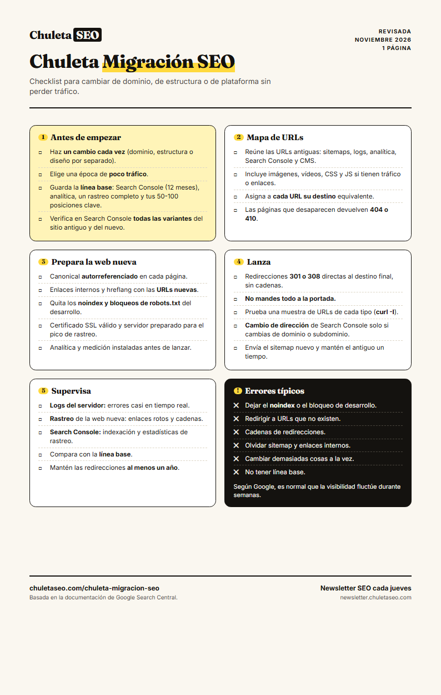

Resúmenes de una página, en PDF, para tener a mano. Cada chuleta condensa una de las guías de ChuletaSEO y se apoya en la documentación oficial de Google (y de OpenAI, en el caso del GEO).
{:.lead}

## Chuleta GEO

Checklist para que tu contenido sea elegido como fuente en AI Overviews, AI Mode y ChatGPT: lo técnico, cómo escribir para ser citado, qué hace cada rastreador de IA y cómo medirlo.

<a class="btn btn-primary" href="/chuleta-geo">Ver la Chuleta GEO</a>

## Chuleta Migración SEO

Checklist para cambiar de dominio, de estructura o de plataforma sin perder tráfico: línea base, mapa de URLs, web nueva, lanzamiento, supervisión y errores típicos.

<a class="btn btn-primary" href="/chuleta-migracion-seo">Ver la Chuleta Migración SEO</a>

## Más recursos

- [Guías SEO de ChuletaSEO](https://chuletaseo.com/fuentes-informacion)
- [Glosario SEO y GEO](https://chuletaseo.com/glosario-seo)
- [Newsletter SEO cada jueves](https://newsletter.chuletaseo.com)
